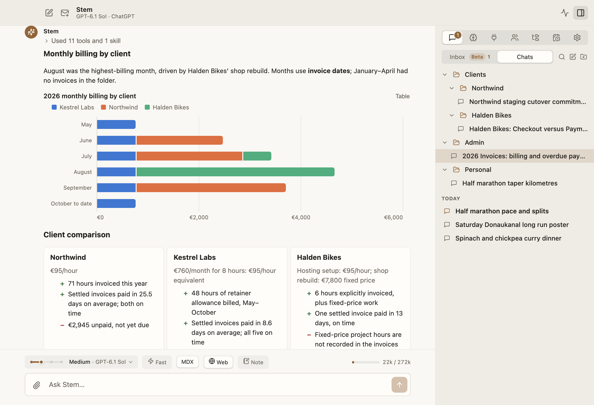

# Chats

← [Stem guide](../README.md)

Maya creates a **Clients** folder, adds a **Northwind** subfolder, and starts a chat
there:

> Review this launch plan. List the three riskiest assumptions.

<picture>
  <source media="(prefers-color-scheme: dark)" srcset="../screenshots/hero-dark.png">
  
</picture>

## Ask

- Drop a file on **This chat** for one message. Drop it on **Files** to copy it into
  Stem for reuse across chats: **Top level**, or one of your Files subfolders shown as
  tiles. When there are more subfolders than fit, the recent ones show, and the last
  tile ("12 more…") lets you pick any folder after the drop.
- Click a picture you attached to open it full-window. **Esc**, a click beside it or
  **✕** closes it. This works for pictures in mail too.
- Choose model, effort, and speed.
- Each chat is **MDX** or plain **Markdown**. In an MDX chat, answers can include
  charts, tables, side-by-side comparisons, KPI tiles, diagrams, step lists, tabs,
  quizzes, forms, and suggested follow-ups you can click. They render as the answer
  streams in. A chart's **Table** button shows its numbers. The toggle in the
  composer sets the format for new chats; in an open chat it switches that chat.
  Markdown chats keep answers plain and send the model less text.
- More effort can use more quota. **Fast** appears only for supported models and
  increases usage.
- Watch tool activity while Stem works: each tool call is a row with a live timer
  while it runs. Once the answer is done the rows fold into one line, such as
  "Used 3 tools and 1 skill" with the total time. Click it to see every call again.
- The mic button in the composer dictates. Speech is turned into text on the
  device, and the audio never leaves it. On a Mac it needs macOS 26, on the phone
  iOS 26; on Windows and Linux it runs Whisper on your computer, downloaded the
  first time you dictate. Pick the language in **Settings → App → Dictation**
  (see [Dictation](settings.md#dictation)); on the phone, hold the mic.
- **Web** turns web search on or off for the next message. It stays where you leave
  it, and is the same switch as **Settings → App → Web search**. Quick Chat keeps
  its own.
- Web answers include cited sources: the sites' icons show under the answer;
  open them for a card per source.
- Places in an answer (an address, a shop, a venue) are links that open Maps.
- The context meter shows how full the conversation is. In a narrow window the
  controls under the message box stay on one row by giving things up: the context
  meter goes first, then the button labels, then **Note** and **Record** (both stay
  in the `/` menu), then the model name. The arrow beside it still opens the model
  picker.
- File paths in an answer are links. A click opens a document, a picture, a sound,
  a video or a web page in Stem's own viewer window, or in its usual app; anything
  else (a folder, a program, a script) is only shown in Finder (Explorer on Windows).
  Right-click for **Open**, **Show in Finder** and **Copy Path**. Links to files in
  your Files or in the chat's scratch folder work the same when Stem runs on a
  server: Stem fetches the file first, and **Show in Finder** saves a copy to
  Downloads.
- A change shown as a diff gets a diff view: removed and added lines tinted, line
  numbers, and the changed words marked. Switch between **One column** and **Side by
  side** in its header, or **Copy diff**.
- When Stem shares a sound (a recording it cut, a clip it made), it appears under the
  answer as a player: play and pause, a waveform you can click or drag to seek, and
  **Save to Downloads**.
- Ask for a picture and Stem draws it with your ChatGPT subscription (see
  [Settings → Image generation](settings.md#image-generation)). Click it to enlarge.
  Under each picture, or on right-click: **Save to Downloads** (straight into your
  Downloads folder, no dialog) and **Copy**. On the phone, tap the picture and use
  **Share**, which has Save Image. To change a picture, just say what to change;
  to edit a photo, attach it and say what to change, or name a picture that is
  already in your Files or a connected folder ("use the logo in my project's art
  folder"). Stem can also save a picture
  for you: "put it in my project's art folder" writes it to Files or to a folder you
  connected read & write, on its own computer when it lives on one (that computer
  must accept commands).

## Organize and find work

- Use **+** on a folder to start a chat inside it.
- Drag chats and folders to move or nest them.
- ⌘-click (Ctrl-click) several chats, or Shift-click a range. A bar over the list
  marks them read or unread, moves them to a folder, archives them, or deletes them
  after asking.
  Dragging one of them moves them all. **Esc** clears the selection.
- Right-click a chat to mark it read or unread, **Archive** it, **Write a subject**,
  **Rename**, move, or delete it. Deletion is permanent, so the confirmation offers
  **Archive instead**. Tasks scheduled from the chat stay: they run on their own and
  report by mail.
- **Archive** (`⌘⇧A`, `Ctrl+Shift+A`) moves a chat out of the list into the folded
  **Archived** section at its foot. Archiving the open chat opens the next one in the
  list (the one above when it was the last), so you can work through a run of chats
  one after another. Nothing is lost: an archived chat still opens and
  shows up in search, with an archive badge. Right-click it and choose **Move out of
  archive** to bring it back, or just continue it: a new message brings it back on
  its own.
- Right-click a folder for **New subfolder**, **Settings…**, **Mark all as read**
  (every unread chat in it and its subfolders), **Rename** or **Delete**. Deleting
  a folder moves its chats and child folders to the parent.
- Use **Search**, `⌘F` on Mac, or `Ctrl+F` on Windows and Linux to search titles
  and message text across every chat.

### Folders that file chats for you

Making a folder asks for a name, an optional description, and **Move matching
chats here automatically**. The same dialog opens again from the folder's
**Settings…**. With that box ticked, once a chat has sat untouched for a day, Stem
moves it into the folder if it fits the name and description. Only folders with
the box ticked receive chats, so a good description matters. When you switch it
on, Stem asks **Move existing chats too?**: **Only new chats**, or **Include
existing chats** to look once at the idle chats outside any folder.

Stem never moves a chat you placed yourself or a private chat. To undo a move,
drag the chat back; it then stays wherever you put it. Filing runs on the same
model as chat subjects (**Settings → Models → Quick tasks**).

### The menu bar

The app's menu bar lists every action that has a shortcut, with its keys beside it,
so it is a good place to learn them. **File** has new chat, new mail, Quick Chat and
**Attach Files…**. **View** opens the side panel's tabs (**Chats**, **Memory**,
**Tools**, **Personas & People**, **Sources**, **Scheduled Tasks**) and has **Actual
Size**, **Zoom In** and **Zoom Out** for the main window. **Chat** has Stop,
effort, Fast, **Archive**, **Snooze…**, read or unread, and **Delete Chat…**.
**Window** lists the first nine chats under ⌘1–9 (Ctrl+1–9). **Settings** and
**Check for Updates…** are under **Stem** on a Mac and under **File** on Windows and
Linux. There is no Close Window item, so ⌘W (Ctrl+W) never closes Stem's window.

## Private chats

On a new, empty chat, click **Make this chat private** before sending. A private
chat is saved like any other and shows up in search, but Stem learns nothing
from it: no memory is written from it, none is read into it, and the recall tools
are off. It cannot be switched back once the chat starts. A lock marks it in the
list. Mail has the same switch (see [Mail](mail.md)).

## Change a conversation

Hover over a message to reveal its actions:

- **Retry**: run that turn again.
- **Edit and run**: replace your message, then continue from there.
- **Fork**: copy the conversation up to that point into a new chat.
- **Delete from here**: remove that turn and everything after it. Requires a second
  click.
- **Pin to this chat**: keep it on the chat's pinboard.
- **Share this answer as a link**: publish the chat, or part of it, as a link anyone
  can open (see [Share links](share-links.md)).

The pinboard is the strip under the chat title, **Pinned in this chat**. Besides
whole messages, you can select a few words of a reply and click **Pin**, or type
`/pin` and a note of your own. Open the strip to see everything pinned, jump back
to where it came from, rename an entry, or drag them into order. Stem keeps what is
pinned in mind for the rest of that chat, even after the conversation gets long.

Type `/` at the start of a message to see the commands the box understands:
`/pin`, `/note`, `/learn`, `/compact` and, on the Mac, `/record`. `/compact`
condenses a long chat's history so it takes less room, and says by how much
("142k → 31k tokens"). Add a focus to say what the condensed version must keep:
`/compact keep the deployment steps`. It cannot run while an answer is still
being written. Only what you type starts a command: text you paste at the start of
the box is sent as it is, even when it begins with `/` or `//`.

Each chat keeps its selected model and effort. Changing them in one chat does not
rewrite earlier answers.

<!-- TODO(screenshot): Message actions on a user message, including Fork and Delete from here. -->
