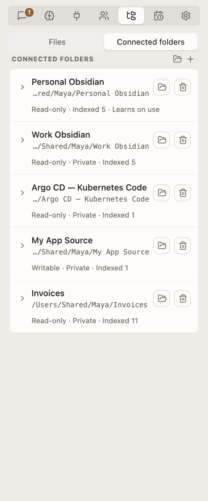

# Connected folders

← [Stem guide](../README.md)

| Connected folder | Kind | Writable | Search index | Remember | Learn facts |
| --- | --- | --- | --- | --- | --- |
| **Personal Obsidian** | Notes vault | No | Yes | Yes | On use |
| **Work Obsidian** | Notes vault | No | Yes | No | — |
| **Argo CD — Kubernetes Code** | Code project | No | Yes | No | — |
| **My App Source** | Code project | No | Yes | No | — |
| **Invoices** | Documents | No | Yes | No | — |

Stem reads connected folders where they already live. The original files are not
copied into Stem.

Open the right sidebar → **Sources** → **Connected folders**. Folders are listed per
machine; each row shows the folder's icon, name, path, and small icons for what is
switched on (writable, private, indexed, learns facts, sync trouble).

  <picture>
    <source media="(prefers-color-scheme: dark)" srcset="../screenshots/panel-folders-dark.png">
    
  </picture>

## Connect a folder

Press **New** and pick what kind of folder it is. The kind fills in every setting,
and you can change any of them before connecting:

| Kind | Starts as |
| --- | --- |
| **Notes vault** (Obsidian, Logseq, Markdown) | read-only, remembered, indexed, learns from every note |
| **Code project** | writable, nothing remembered, not indexed |
| **Documents** (PDFs, contracts, manuals) | read-only, remembered, indexed, learns from what comes up in chats |
| **Confidential** (a client's files, medical or legal papers) | read-only, indexed, nothing remembered |
| **Something else** | read-only, remembered, indexed; you answer each setting |

The **Connect a folder** wizard then has three steps. **Folder**: the path, a name,
and optionally what is in it; Stem is told that note, so it knows when the folder is
worth a look. **Suggest for me** lets Stem look at the folder's file names and README
and fill in every step, with its reason shown. **Access**: **Read-only** or
**Writable**. **Memory**: **Remember** or **Keep private**, and how it learns facts.

## Change a folder

Click a folder to open it. The header has **Suggest settings** (the same suggestion
as in the wizard, filled into the form), **Reveal in Finder** and **Disconnect
folder**. Three tabs hold the settings, and nothing changes until you press **Save**:

- **About** — the folder, what is in it, and its **Kind**, which only sets the icon.
- **Access** — **Writable** lets Stem create, edit, or delete files when asked.
  **Remember what it reads** lets content read from this folder become cross-chat
  Memory; off, the folder is private.
- **Search & learning** — **Search index** scans supported files and builds a search
  catalog on this computer; **Learn facts** and its model (see below).

Read-only protection stays active even in Yolo mode, and Writable takes effect on
the folder's computer at once. Content used in a turn goes to that chat’s selected
model: its provider service for a cloud model, or the configured local server for a
local model. Enable **Writable** for a code project only while Stem is editing it.

**Disconnect folder** removes access and deletes the local index. It never deletes
the original folder.

## Index details

The index reads Markdown (`.md`, `.markdown`), plain text (`.txt`, `.text`), Word
documents (`.doc`, `.docx`), and PDFs with a text layer (`.pdf`). Stem skips scanned,
image-only PDFs. It can still open other files directly while working in the folder,
and it reads a PDF's text when it opens one.

The catalog stays on your Stem. Turning the **Search index** off deletes the catalog
and scan/learning progress; Save warns first. Learned facts remain. Turning **Remember
what it reads** off keeps folder content out of cross-chat Memory, but Stem can still
use it for the current task.

## Learn facts

Available only when the **Search index** and **Remember what it reads** are both on.
**Learn facts** controls when Stem automatically turns durable details from indexed
documents into [facts](memory/facts.md). No need to ask it to remember each one:

- **Off** — never learn facts from the connected folder.
- **On use** — learn only from excerpts that surface in chats; no extra model calls.
- **New & changed** — also process files added or edited from now on.
- **Full history** — first process every indexed file, then continue with new and
  changed files.

Choose the learning model on the folder. **Memory default** uses the Memory model. A
cloud model receives the excerpts it processes and may add provider usage cost.
**Full history** shows an estimate before it starts, and the button reads **Save and
start**. A document's "I" or a name in a file is not taken to be you.

A fact learned from a file starts **unconfirmed**. Stem finds it when it searches its
memory for an answer, but does not bring it up on its own. To change that for one fact,
confirm or pin it in [Memory → Facts](memory/facts.md) (the **Unconfirmed** filter lists
them).

The **Claude Code** folder has two choices, **Off** and **On use**. With **On use** Stem
reads Claude Code's memory notes as they are added or changed. A session transcript
teaches Stem only when an excerpt of it comes up in a chat; the transcripts are never
sent through the learning model in bulk.

Learned facts remain if their source file is deleted. On disconnect, Stem asks whether
to forget facts learned from that folder; pinned facts are kept.

## Folders on your other computers

When Stem runs on a server, the wizard asks where the folder lives: **On the server**
(browse the server's own disk) or **On this computer**. Picking a
folder on this computer connects it as a **mirror**: this computer watches the folder
and copies changes one way, up to the server, so Stem can read it even while this
computer is asleep. This is the one kind of connected folder that IS copied — the
Connected folders tab groups it under this computer's name and shows when it last synced.

- The first sync copies the whole folder, one file at a time — for a folder with
  tens of thousands of files that takes minutes to hours, not seconds. The folder's row says
  **Waiting for the first sync** until the entire first pass lands, and the toolbar's
  background-activity panel shows a **Syncing** row with a file-count progress bar.
  A long "Waiting for the first sync" with a moving progress row is a big first upload
  doing its job, not a problem.
- Interruptions are safe: quitting the app, the server restarting, or the
  connection dropping pauses the sync, and the next round resumes from what already
  arrived instead of starting over.
- After the first sync, changes sync within seconds while this computer is online;
  deletes and renames follow. The folder on this computer is always the original —
  nothing Stem does can change the mirror's contents from the server side.
- Mirrors skip `.git`, `node_modules`, OS junk files, whatever the folder's own
  `.gitignore` files leave out, symbolic links, and files over 25 MB. Anything else
  skipped is counted on the folder's page.
- If the folder disappears (an unplugged drive, a rename), syncing freezes and the
  folder's row says so — the mirror keeps its last state rather than treating it as deleted.
  Disconnecting the folder in Stem is how you delete the mirror.
- **Writable** means something different here: Stem edits the folder by running
  commands **on this computer** (so [command execution](../running-on-a-server.md)
  must be switched on here), never by writing into the mirror. The edit then syncs
  up like any other change.
- Search index, Remember what it reads and Learn facts work exactly as above — they operate on the
  server's mirror copy.

Unpairing the computer leaves the folder listed and frozen, never silently deleted.
Mirrors do not travel in a [backup or move](moving-and-backups.md); after an import,
reconnect the folder from the computer it lives on.
