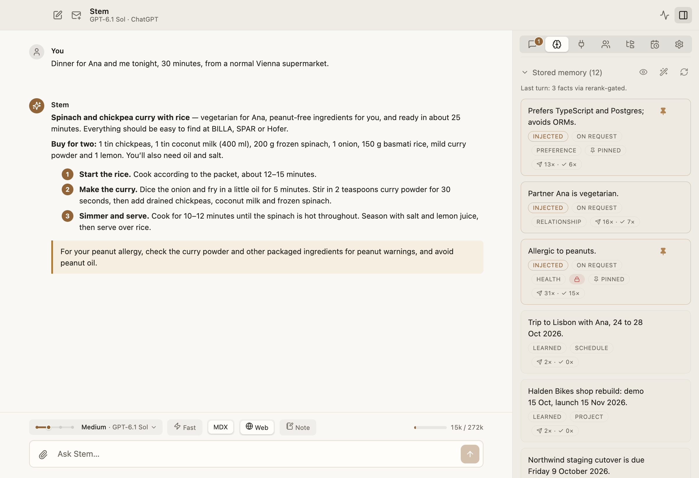

# Memory

← [Stem guide](../../README.md)

With **Memory** on, Stem learns stable, reusable details from ordinary
conversations. You do not need to say “remember this.”

- “My App Source uses pnpm.” in a normal chat may become a **fact** automatically.
- “What did we decide about the Invoices workflow?” can use **Recall**.

Open the right sidebar, choose **Memory**, then choose:

- [**Facts**](facts.md) — the summary of you, the **Deep check**, and the durable
  details Stem can use in later chats.
- [**Past chats**](recall.md) — searchable chat history and conversation summaries.

<picture>
  <source media="(prefers-color-scheme: dark)" srcset="../../screenshots/memory-dark.png">
  
</picture>

## Summary of you

Facts reach a chat one at a time, when the message is about them. On top of
that, Stem keeps a short **summary of you** — work, personal context, how you
write and work, what is on your mind lately, and a brief history — and sends it
with every chat that can see your memory. It is at the top of **Memory → Facts**, under **What Stem knows about you**.

- It is written from your facts and from your own recent messages, in the same
  background pass that learns facts from your chats. Mail written by personas,
  scheduled-run prompts and private chats are never read.
- It rewrites itself once enough facts changed or you have written enough since.
- **Edit** to correct it by hand (or **Write it yourself** before Stem has);
  later rewrites keep your corrections. **Rewrite** starts over and drops them,
  after asking.
- It leaves out sensitive details (health, money, addresses) and facts learned
  from connected folders.
- The one exception is **Current situation**, the first section: where you are
  and what you are in the middle of right now, such as a hospital stay, recovery
  after an operation, or a trip, with its dates. It names the circumstance, not
  your medical details, so that an answer never ignores it. It is rewritten as
  soon as Stem learns that the situation changed, and it is left out of mail
  with other people. Edit the summary to remove or correct it.
- It describes you; it never overrides your custom instructions.
- Private chats and personas without memory access never get it. The switch on
  the card turns it off everywhere.

Connected folders can also teach Stem facts. **Remember what it reads** allows retention;
**Learn facts** chooses when learning happens. See
[Connected folders](../connected-folders.md).

## Models, and machines that cannot reach the internet

Searching memory by meaning needs language models that run inside Stem — nothing
you install, and nothing leaves your computer once they are there. The first time
memory search runs, Stem downloads them and keeps them in its own folder from then
on: the EmbeddingGemma 2 embedder (about 315 MB), which finds candidate facts, the
Qwen3 reranker (about 1.2 GB), which checks them against your message, and Stem
GTE Memory (about 340 MB), which picks the facts worth sending. Other embedders and
rerankers are one pick away if disk is tight; they measured worse.

They live in **Settings → Models → Memory recall → Finding relevant facts**. The
line under each model says where it is: *Preparing model…*, *Ready · 768-dim*, or
an error. A line at the top of that group says when what you run is not the
measured-best setup. If a model fails, a banner at the top of **Memory → Facts**
says so, and **Review setup** opens that group. Until it is fixed, facts are ranked
by similarity alone.

Stem does not ship these models, and it is not a mirror for them: they come from
[Hugging Face](https://huggingface.co), whose terms and licences are between you
and them. On a locked-down work laptop that download is often blocked, and the
line stays on an error.

**Import model files** in that same group is the way through. Get the model
folder however you can and point Stem at it:

- copy Stem's model folder from a computer where memory search already works
  (`Application Support/Stem/embed-models` on macOS, `%APPDATA%\Stem\embed-models`
  on Windows, `~/.config/Stem/embed-models` on Linux) — a USB stick is fine;
- or download the model from its Hugging Face page, or with
  `huggingface-cli download`, on any machine that can reach it.

Either shape works — Stem finds the model inside the folder you choose and copies
it into place, then loads it. If something is missing it says which file, rather
than failing later with nothing you can act on. Nothing already in Stem's folder
is overwritten.

If Stem runs on [a server](../running-on-a-server.md), the folder has to be on
that machine — copy it there first, and the picker will browse the server's disk
rather than yours.
