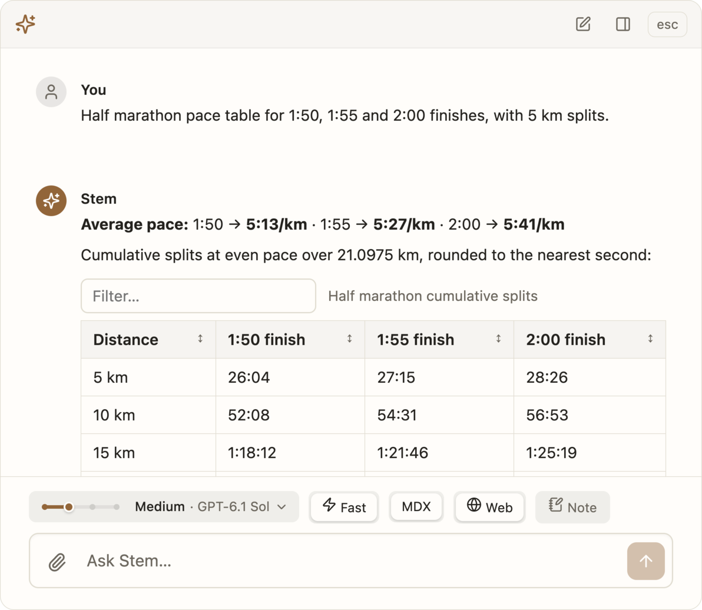

# Quick Chat

← [Stem guide](../README.md)

Maya is editing a client proposal in another app. She presses her Stem shortcut,
asks “Turn this paragraph into three concrete outcomes,” and presses Enter. The
window disappears so she can keep working.

  <picture>
    <source media="(prefers-color-scheme: dark)" srcset="../screenshots/quick-chat-dark.png">
    
  </picture>

## The answer follows you

A small status pill shows progress. When the answer is ready, press the shortcut
again or click the pill.

  <picture>
    <source media="(prefers-color-scheme: dark)" srcset="../screenshots/status-hud-dark.png">
    
  </picture>

- **Esc** hides Quick Chat. In Note mode, the first **Esc** leaves Note mode; press it
  again to hide.
- **Open in Stem** hands the live conversation to the main window.
- **New thread** (`⌘N`, or `Ctrl+N`) starts fresh. The previous conversation remains in **Chats** —
  in the Inbox, or under **Archived** if **Settings → Quick Chat → Skip the
  Inbox** is on.
- Effort and speed affect this conversation only. **Web** is Quick Chat's own
  web-search switch: it stays where you leave it, separately from the main window,
  and is the same switch as **Settings → Quick Chat → Web search**.
- **Note**—or starting with `/note ` or `//`—is the optional direct-save path for
  Memory. No chat turn. Memory must be on; credential-like text is not saved.

On Linux under GNOME on Wayland, the pill sits in the bottom-left corner only with
Stem's GNOME extension (**Settings → Features → Computer control**); without it, GNOME
places the pill itself. Linux also gets a tray icon with **Summon Quick Chat**,
**Open Stem** and **Quit Stem**. Stock GNOME shows tray icons only with the
AppIndicator extension.

## Ask about this window

Maya is in Slack and Jana has asked her to decide something. She presses her
**Ask about this window** shortcut. Quick Chat opens beside the Slack window,
not on top of it, with a chip showing which window it captured. She asks
“What does Jana need from me?” and the answer appears right there.

- The chip shows a picture of the window. Its text goes along too, so the
  assistant reads names and messages exactly. Click **×** on the chip to ask
  without the window.
- If an MCP server covers the app, a second chip names it. The assistant uses it
  to read what the window doesn't show and to act in the app, and shows you
  what it will send before sending. See
  [Works with apps](tools/mcp-servers.md#works-with-apps).
- With computer control allowed for this computer (**Settings → Features**), the
  assistant can also click and type in that window.
- Nothing is captured until you press the shortcut.
- The panel sits right of the window, else left, else below or above. It covers
  the window only when the window fills the screen. It follows the window if you
  move it.
- Every window gets its own panel and its own conversation, so you can ask
  about several windows at once: asking about a second window leaves the
  first one's panel open, and both can be answering at the same time.
- Pressing it in a window whose panel is open puts you back in that panel;
  pressing it while typing in a panel closes that one. Pressing it again in a
  window you asked about earlier continues that window's conversation.
- **+** in the panel's header (**New tab about this window**, `⌘T`) starts another
  conversation about the same window, as a tab, with a fresh picture of it. A
  window holds up to five tabs. Each tab is named after its first question; a dot
  marks one that is answering or has a new answer. `⌘W` closes the tab you are in
  (stopping its answer), and `⌘⇧[` / `⌘⇧]` go to the tab before or after. On
  Windows and Linux, use Ctrl.
- **Shrink** in the header, or `⌘M`, shrinks the panel to a small pill beside its
  window and gives the keyboard back to that window. Clicking back into the window
  while an answer runs does the same. The pill shows the answer's progress; click it
  to open the panel again, with your draft and the conversation as you left them.
- On a Mac, a window that floats above the others, such as an app's hotkey
  window, counts as the window in front.
- On a Mac it needs **Screen Recording** for the picture and **Accessibility**
  for the text. If one is off, the chip says which and opens the right System
  Settings pane. On Windows it needs no setup. On Linux it needs the GNOME
  extension from **Settings → Features → Computer control**.

Set the shortcut under **Settings → Quick Chat → Ask about this window**. It is
off until you record one. On GNOME (Wayland) apps can't set global shortcuts:
copy the command shown there and add it as a custom shortcut in GNOME's
Keyboard settings.

On a Mac, **Keep with its window** below the shortcut makes a panel behave like
part of its window instead of floating over everything: other windows can cover
it, it comes forward with its window, and it hides while that window is minimized,
hidden or on another Space, then comes back with it. It is off by default.

Quick Chat has its own thread. Set its defaults in
[**Settings → Quick Chat**](settings.md).
