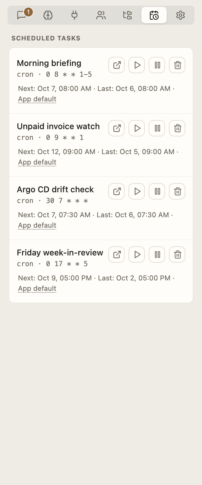

# Scheduled tasks

← [Stem guide](../README.md)

Maya creates tasks by asking in a chat:

> Every Monday, check whether all software installed on this Mac is supported by
> the next macOS version currently in beta. Alert me only about unsupported or
> unknown apps, with source links.

> Every Friday, find AI-generated sci-fi short films released that week on YouTube
> or discussed on Reddit. Show only well-liked films, with direct links and visible
> audience signals.

Every run starts fresh, in a thread of its own, and anything it has for Maya
arrives as mail in the Inbox.

  <picture>
    <source media="(prefers-color-scheme: dark)" srcset="../screenshots/panel-tasks-dark.png">
    
  </picture>

## What to expect

- Stem must be running. If Stem is closed or the computer sleeps, each overdue task
  runs once when Stem can run again.
- If the server stops in the middle of a run, the run is recorded as cut off by a
  server restart and runs once more when Stem starts again. A run cut off twice in a
  row is not retried; it waits for its next scheduled time, and the task's row says
  why.
- Times use the local time of the machine Stem runs on: your computer, or your
  server if you moved Stem to one.
- Each run starts with an empty context: the task’s prompt, the persona it runs
  as (if any), and your memory. Nothing said in the chat that created the task
  carries over, so the prompt has to say everything the run needs. Stem writes
  prompts that way when it schedules a task. Tasks from before this behaviour
  were rewritten once, on the first start after the update, from the chat each
  was scheduled from; a mail lists them, and each shows its previous prompt on
  its **Prompt** tab with a **Revert to the original** link until you revert or
  edit it.
- Runs use the app’s default model and effort, unless the task runs as a persona
  (its model settings apply) or pins a model of its own in **Scheduled tasks**
  (see below).
- Runs can use enabled tools. Web-search tasks request search automatically. Native
  search needs a compatible model; otherwise enable a search-capable tool.
- A run that has something for you sends **mail**: all firings of one task share
  one conversation in the Inbox (a task scheduled from a mail conversation reports
  in that conversation), and the run’s full reply is attached beneath the
  notice once it finishes. Each run is also shown what the task's earlier runs
  already mailed, so a watch task reports a finding once rather than every morning.
  A run that finds nothing leaves no trace, and no run ever makes a chat unread.
  Pictures a run makes arrive with its mail; a run that made any always mails, since
  its thread is the only place they are kept. By default the notice also pops up and brings Stem to the
  front; Settings → App → **Notifications** turns that down to a dock bounce, or to
  nothing but the mail.
- When a task starts failing, one mail says so with the reason. Repeated failures
  are shown on the task’s row instead (it moves to **Needs attention**), and a
  recovery sends nothing.
- A one-time task disappears after its scheduled run finishes, even if it fails.
- A command that needs your approval does not fail the run: the run waits, and its
  mail in the Inbox asks with **Allow once** and **Deny**. Your answer resumes the
  run. Under **Assisted** approval, the safety check reads the chat the task was
  scheduled from to judge what you asked for.

## Task controls

Open **Scheduled tasks**. Tasks are grouped **Needs attention** (failing),
**Upcoming** (soonest first) and **Paused**. Each row reads the schedule in words
("Weekdays at 08:00 · Secretary") with the next run or a status on the right. New
tasks are made in a chat: **New in chat** starts one.

Click a task to open it. The header has the on/off switch (pause or resume), **Open
chat** (the chat the task was scheduled from; runs do not appear there), **Run now**
(a test that leaves the next scheduled time alone) and **Delete task**, which asks
once. A failing task shows its last error on top. Three tabs:

- **Prompt** — the full instruction every run re-executes, and **Runs as**: the
  **App default model**, **A model of its own…** (pick the model, and optionally an
  effort), or a **persona**. A persona run uses that persona’s role prompt, coding
  setup, private memory, and model settings, and its mails arrive from that persona.
  Each run also lets the persona save what it learned into its notes, as a mail
  delivery does. A task never has both a persona and a model.
- **Schedule** — the cron expression (minute · hour · day · month · weekday) in the
  Stem server's time, or the date and time of a one-time run. Save refuses an
  expression that can never fire, and a time already in the past.
- **Runs** — each firing with its time and outcome: *Mailed* with the mail's subject
  and an **Open** button, *Nothing to report. No mail sent.*, *Waiting for your
  approval in the Inbox*, or the failure's reason. A run that mails nothing leaves
  only this line.

Changes on the Prompt and Schedule tabs are written together when you press **Save**.
Deleting a task keeps its mail in the Inbox; the hidden threads its runs left behind
are removed. A failure's reason is also in the log (`stem.log` in Stem’s state
folder), which is where to look if the task is gone.

To change the instruction or timing, edit the task here, or ask Stem in any chat
("sign the Monday report as Stem", "move the backup check to 7:00", "pause the
weekly film search"). Stem sees all your tasks from any chat, whichever chat
scheduled them, except the tasks of private chats and private mail. It changes the
task in place; the **Prompt** tab then says *Edited by Stem in a chat* with **Revert
to the original**. Deleting the chat a task came from leaves the task in place.
