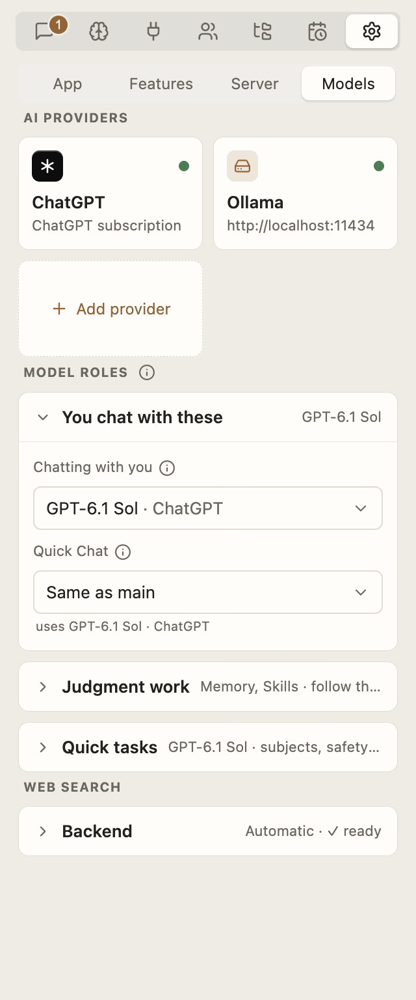

# Settings

← [Stem guide](../README.md)

Maya uses ChatGPT for everyday consulting, adds a local Ollama model for sensitive
drafts, keeps command approval on **Assisted**, and gives Quick Chat short-answer
instructions.

<p align="center">
  <picture>
    <source media="(prefers-color-scheme: dark)" srcset="../screenshots/panel-models-dark.png">
    
  </picture>
</p>

Settings has four tabs: **App** (appearance, the conversation, Quick Chat, dictation,
the Escape key, notifications, About), **Features** (mail among personas, your email
address, shared links, image generation, commands, coding agents, computer control,
browser control), **Server** (where Stem runs, your devices, moving or backing up) and
**Models** (providers, which model does which job, memory recall, web search).

## Search settings

**Search settings**, the field above the four tabs, finds a setting by its name, the
line under it, or the text of its ⓘ explanation, across all four tabs. When you open
Settings yourself (⌘, or Ctrl+,, the menu, or the side-panel button), the cursor is
already in it. Matches found only in an explanation are listed under **In
explanations**. Click a result, or pick one with the arrow keys and Enter: Stem
switches to its tab, opens the groups it sits in and scrolls to it. **Esc** clears
the field; a second **Esc** leaves it.

## Providers and models

Add a provider with:

- **Account**: ChatGPT, Claude, or Grok sign-in. Grok signs in with a code you
  confirm in the browser (SuperGrok or X Premium).
- **API key**: Anthropic, OpenAI, OpenRouter, or xAI.
- **Local server**: Ollama or LM Studio. Stem hides Ollama models without tool
  support; they cannot complete Stem turns.
- **Custom endpoint**: any other OpenAI- or Anthropic-compatible server, named by
  you. This is also how you add a second Ollama — one on your laptop as the local
  server, one on the office PC as a Custom endpoint with its address and a name.
  Leave **Model IDs** empty and Stem uses whatever the endpoint lists, re-checked
  every half minute, so a model pulled there later shows up by itself. Type IDs
  to pin a fixed set, which an endpoint that lists no models needs.

Click a provider to open its page: whether it answers, its address, its models,
and the buttons to check it again, reconnect, or disconnect. The dot on each tile
is red when the last check got no answer, and the page says why. A server that
stops answering keeps the models it listed last, so a chat already on one of them
does not lose its model.

With a ChatGPT sign-in, the **ChatGPT** tile shows how much of your plan's usage is
left ("5h 62% · week 80% left"). Its page has a bar for each limit, **5-hour limit**
and **Weekly limit**, with the percentage left and when it resets. The bar changes
colour as a warning at 25% left and again at 10%. If Stem cannot read the figures,
**Plan usage** on the page says why.

### A model server on your Mac, with Stem on a server

When Stem runs on a server and LM Studio or Ollama runs on your Mac, set **Runs
on** to your Mac (adding the server from that Mac picks it for you). Stem then
reaches the model server through the Mac's own connection to Stem, so
`http://localhost:1234` means LM Studio on the Mac. The Mac has to be awake with
Stem running; while it isn't, the provider shows as not answering. The Mac only
forwards model requests to itself or its local network.

The selected model receives the prompt, attachments, and context Stem adds to that
turn. A cloud model receives that data on its provider’s service. A local model
sends it to the server address you configured.

### When your endpoint doesn’t describe itself

Stem shows the thinking-effort control — Off, Low, Medium, High, X-High — only for
a model that says it can think. Most servers say so; some don’t. A Qwen3 behind
your own endpoint often arrives looking like a model that cannot reason at all, so
it answers with thinking switched off and there is no control to switch it on.

Open the connected **Custom** server to get **Per-model overrides**, and tell
Stem what the endpoint didn’t:

```json
{
  "qwen3-32b": {
    "reasoning": true,
    "thinkingLevelMap": { "off": "off", "low": "low", "medium": "medium", "high": "high" },
    "compat": { "thinkingFormat": "qwen-chat-template" }
  }
}
```

Each key is a model id your endpoint serves. `reasoning` is what makes the control
appear; `thinkingLevelMap` says what to send for each level, and a level your
server can’t do goes in as `null` so Stem stops offering it. `thinkingFormat`
names how the request carries the thinking flag — which format yours wants is
something your server’s own documentation will tell you.

If you already run this endpoint under pi, you don’t have to type any of that
again. Open **Import from a models.json**, paste the file in, and pick the
provider — Stem pulls out what each model needs, folds the provider-wide settings
into every model, and fills the box in. Nothing is saved yet: read what it wrote,
change what you like, then Save.

Save re-checks what you typed and refuses anything that would leave Stem unable to
talk to any of your servers, so a wrong guess costs you a message under the box and
nothing else. Overrides stay put — Stem re-applies them every time it refreshes the
model list, and keeps them if you disconnect the endpoint, filling them back in
when you add one again.

This box is for the **Custom** server. If you need it for LM Studio, add LM Studio
as a Custom endpoint instead, with the URL `http://localhost:1234`.

### Model roles

Stem runs more than one model. Under **Model roles**, each group's header says what it
runs on now, and a role left unset follows its group:

- **You chat with these** — the model that writes your replies (give it your best one),
  and Quick Chat's model.
- **Judgment work** — **Memory** (learns facts, writes summaries, tidies memory, runs
  the Deep check), **Skills** (writes skills, `/learn`, skill tidy-up) and the **Command
  safety check**'s review. Unset, they follow the model you chat with.
- **Quick tasks** — small jobs a fast model does well: chat subjects, filing chats into
  folders, picking which of your skills a message needs, and the safety check's quick
  first pass.

**Memory recall**, below the roles, sets how many facts go with each message and the
models that pick them (see [Memory](memory/README.md#models-and-machines-that-cannot-reach-the-internet)).

### Web search

**Web search** works with every model, not only cloud ones, and returns cited
sources. Under **Web search** you choose the backend that runs the search:
**Automatic** ends at one that needs no key, or pick a named one and paste its key.

Two backends need no key of their own because a connected account pays for them:
**ChatGPT / OpenAI** with a ChatGPT sign-in, and **Grok / xAI** with a SuperGrok or
X Premium sign-in. Grok runs the search inside Grok itself, so each search draws on
the same allowance as your Grok chats — one question can use a dozen searches. It is
never picked automatically; select it yourself if you want it.

## Command approvals

Turn **Run commands** off to disable shell commands. With **Assisted**, the safety-check
models (**Settings → Models**) receive the command, its working folder, and what you
wrote in the conversation. A cloud model processes that text on its provider.

Commands run on the machine Stem itself runs on: your own computer normally, or your
server if you [moved Stem to one](../running-on-a-server.md) — so they see the programs
installed there, not the ones on the computer you happen to be typing on. On macOS and
Linux they run under `zsh`, or `bash`/`sh` on a machine without it; on Windows under
Git Bash when it is installed, otherwise `cmd.exe`.

**Approval mode** governs every command, the ones Stem runs itself and the ones a coding
agent asks to run:

- **Manual**: known-safe and always-allowed commands run; everything else asks first.
- **Assisted**: an AI safety check reads what you asked for (your own messages, never
  the assistant's explanations or file contents) and runs the commands that serve it.
  A quick first pass clears the obvious ones; the rest are reviewed more carefully
  before anything is refused. A refused command goes back to the assistant with the
  reason, to find a safer way. After three refusals in a row you decide: a card in a
  chat, or, for mail and scheduled runs, an approval in the Inbox that pauses the run
  until you answer. A convenience, not a security boundary.
- **Yolo**: commands run without asking. Read-only connected folders remain
  protected.

With **Assisted**, three boxes let you steer the safety check in your own words:
**Always allow** (what may run without asking), **Never allow** (what must always come
to you; it wins over everything else), and **About my setup** (which machines, folders
and services are yours and how much they matter).

A command may run for up to an hour; longer jobs are started in the background and
checked on. Up to eight commands run at the same time; further ones wait their turn.

On an approval card, **Always allow** saves a command prefix for future turns.
Keep prefixes narrow; `git status` grants less access than `git`. Approval cards
never create regex rules.

The Always-allowed commands editor also accepts manually defined **Regex** rules.
Stem matches one rule against each complete command segment, exactly as written,
including quotes and repeated whitespace. Matching is case-sensitive and implicitly
anchored at both ends, so explicit `^` and `$` anchors are unnecessary. For
example, this permits `kubectl get` with an optional kubeconfig before the verb
while leaving `kubectl delete` unmatched:

```text
kubectl(?:\s+--kubeconfig(?:=\S*|\s+"[^"]*"|\s+\S+))?\s+get(?:\s+.*)?
```

Every segment in a chain must match a Prefix or Regex rule independently. Regex does
not bypass protected-folder checks, unsafe command flags, or other command guards.
These expressions use JavaScript regex: overly broad rules grant broad authority,
and pathological expressions can make command approval unresponsive despite Stem's
length limits. Regex rules currently cover commands run by Stem's server only;
paired computers keep their separate prefix-only lists.

A card waits ten minutes for an answer. Only the card on screen counts down; when
several commands are waiting, each one's ten minutes starts when it becomes the card
in front of you. If nobody answers in time the command is dropped, and the assistant
is told that nobody answered — never that you refused. Any surface can answer: a card
raised while your phone was asleep is waiting for it when it reconnects.

On Windows, **Windows shell** defaults to Git Bash when Git for Windows is installed,
and falls back to Command Prompt if it is not. Stem looks for it without using
PowerShell, and only Git for Windows counts: WSL ships a `bash.exe` of its own, but
it runs in a Linux VM whose paths the read-only folder guard cannot check. If Git is
not in a usual place, paste the path to its `bash.exe`. Commands
then run in that one shell — quoting and the always-allowed list follow it (`dir`
vs `ls`). Pick Command Prompt yourself if you want cmd.exe even though Git is
installed.

<!-- TODO(screenshot): Command approval card with Allow once, Always allow, and Deny. -->

### Commands on your own computer

With Stem on a server, the assistant can also run a command on one of your own
paired computers — "download this video on my Mac" — but only after that computer
says yes: **Run commands on this computer**, at the bottom of this section *on that
machine*, is off until you switch it on there, and there is no way to switch it on
from anywhere else. Withdrawing consent is the same switch; commands stop
immediately.

Commands on a paired computer are for shell work there: files, git, scripts, opening an
app. Driving its screen — System Settings, clicking, typing, AppleScript at its apps — is
what a persona that runs as **Computer** (its editor's **Runs as** tab → **Screen and
apps**), or a chat allowed to control that Mac (see [Coding agents and computer
control](#coding-agents-and-computer-control)), does with its `computer` tool, under your
consent switch and banner. Once a persona is pinned to a computer, a GUI-scripting command
from any conversation that may not drive it is refused and told to hand the task over;
with no persona pinned, the command runs under the usual policy.

Once a computer accepts commands, they face the same approval policy as everywhere
else, with one deliberate difference: nothing is pre-approved there. Even commands
Stem considers routine ask (or pass the safety check) until you choose **Always
allow** — and an Always allow given for that computer trusts the prefix on that
computer only. The per-machine lists appear under the shared one and are edited the
same way. The approval card always names the machine a command would run on.

What runs there stays there: the command's output lands on that computer (in a
per-chat scratch folder unless the assistant names a folder like Downloads), and
your Files place stays with the server.

### Scratch files

Commands run in a folder of their own per chat, so downloads, scripts and build
output stay with the conversation that made them. **Scratch files** lists those
folders biggest-first with the chat each belongs to; **Clear** empties one without
touching the conversation.

A folder goes when you delete its chat, and otherwise once nothing in it — and
nothing in the chat — has been touched for the period you choose (7, 30 or 90 days,
or **Never**). Treat scratch as working space: anything you want to keep belongs in
your Files, which the assistant can copy into and which is not swept. Scratch is
also left behind when you move Stem to another machine.

## Coding agents and computer control

A coding agent (Claude Code, Codex, OpenCode, …) takes programming work off Stem's
hands; computer control lets Stem see a computer's screen (Mac, Windows, or Linux with
GNOME) and click and type there. Both
come from two places, and a conversation gets them from exactly one:

- **A persona** gets them from its own setup, on the **Runs as** tab of its editor in
  the Personas tab: **Coding agent** (the agent, where it runs, its folder and model)
  or **Computer** (**Screen and apps** for a Mac's screen, **Browser** for the Stem
  extension). A persona without one has no coding agent, or no computer control —
  whatever the switches below say. Computer control is in **Alpha**. Chatting as your
  Secretary will not start Claude Code unless the Secretary has a coding setup.
- **A chat with no persona** (Quick Chat included) gets them from Settings → Features →
  Coding agents / Computer control → **Allow in chats**. Off by default. The switch
  belongs to your Stem server, so it covers chats from every device, the phone too.
  Scheduled tasks never use it: a task that needs a coding agent runs as a persona that
  has one.

When a chat is allowed, the row under the switch says where the work goes:

- **Let the model choose**: the chat is told which agents Stem knows and which
  computers have switched the feature on, and picks from them per request ("fix the
  build on the Linux box with Codex"). Suits strong models.
- **A fixed computer** (and, for coding, an agent): every chat's run goes there, and the
  model has nothing to decide. Suits small or local models. The agent has to be
  installed on that computer; if it is not, the run fails with the agent's own error.

A chat uses these only when you ask: it does not start a coding agent for an ordinary
question. It works in the folder you name ("fix the tests in ~/code/app"). Left
unnamed, a run on Stem's own machine uses the chat's scratch folder, and a run on
another computer stops to ask you which folder. A computer that is asleep or has
Stem closed fails right away with a message saying so; nothing is queued.

Each computer still has to agree for itself: **Run coding agents on this computer**
and **Let Stem control this Mac** (or **this computer** on Windows and Linux), in the
same section *on that machine*. Command
approvals apply to what a coding agent runs, the same as for personas. A persona that
drives Claude Code can instead switch on **Approves its own actions**: Claude Code's own
check then decides each step, so routine work never waits on a card, and Stem shows no
cards and keeps no approval log for that persona.

If Stem says it cannot use a coding agent or control the computer, it names the
reason: the chat runs as a persona without that setup, or chats are switched off here.

On Linux, computer control needs GNOME on Wayland. Once you switch it on, a
**GNOME extension** row appears: **Install** puts Stem's GNOME Shell extension in your
extensions folder. GNOME loads a new extension only at login, so log out and back in
once; the row then says **Running**. Later updates to the extension arrive without
logging out. You can turn the extension off in GNOME's Extensions app. Two Wayland limits apply when Stem works inside one window instead of
the whole screen: that window gets no key presses, only text typed into a field and
buttons pressed by name, and some GTK 4 lists can be selected but not opened. Working on
the whole screen has no such limits.

On Windows, computer control works on Windows 10 and 11 with nothing to install.
Working inside one window, Stem can type and press plain keys there, but not Ctrl,
Alt or Shift combinations; it uses the window's menus instead, or the whole screen.

**Browser control** follows the same rules with its own pin and its own switch: a
persona's **Browser** (Runs as → Computer), or Settings → Features → Browser control →
Allow in chats, plus **Let Stem control this Mac's browser** (**this computer's
browser** on Windows and Linux) on that computer itself. Setting up the extension is
described on the [Browser control](browser-control.md) page.

## Your email address

Settings → Features → **Your email address** is the address other people's Stems
reach you at. Type it in and Stem emails you a code to confirm it is yours. Once it
is confirmed, you can [mail people who use Stem](other-stems.md), and your [share
links](share-links.md) carry it. **Only people I've written to can reach me**,
**Your key** and your **Contacts** appear here too.

If your organization runs Stem for you, this section may say **Turned off by your
organization** (no mail with other Stems and no public links) or **Limited by your
organization** (only addresses at its domains, through its relay).

## Image generation

Ask for a picture in plain words ("draw a sprout in a terracotta pot", "make a logo for
…", "make the sky darker") and Stem makes it and shows it in the reply. It can also
start from a photo you attach. Pictures come from your **ChatGPT subscription**, not an
API key, so this needs a ChatGPT sign-in under Models, and each picture uses your plan's
image allowance. One picture takes 20–60 seconds. While it's being made, the reply shows
a placeholder with a timer, and Stop cancels it.

Settings → Features → **Image generation** switches it on or off for every chat and
persona at once, mail and scheduled runs included. It is on by default whenever you're
signed in with ChatGPT. Code personas never make images: they only relay to their
coding agent.

The assistant sees the pictures it made, so you can ask for changes. Only the newest
three stay in its view as pictures. Older ones stay in the chat and can still be edited
when you ask. Pictures are kept with the chat and deleted with it. Your prompt, and any
image used as a starting point, go to OpenAI, even in a private chat.

## Appearance

Under **Settings → App → Appearance**, set per computer:

- **Theme** — **System** follows the OS; the others include Catppuccin, Gruvbox,
  Solarized, Nord, Rosé Pine, One, Everforest, Kanagawa, Dracula, TokyoNight Storm and
  Cotton Candy (pink, light and dark). For a theme with
  both palettes, **Light or dark** picks **Follow the OS**, **Always light** or
  **Always dark**. **Themes folder** opens the folder where you can add your own; copy
  `_example.json` to start one.
- **Chat layout** — **Rows**, or **Bubbles** with your messages on the right.
- **Chat width** — **Comfortable**, **Wide**, **Wider** or **Full**, for large screens.
- **Translucent sidebar** (macOS) — lets the desktop show through the toolbar and
  side panel.

To make everything in the main window bigger or smaller, press ⌘+ (or ⌘=), ⌘- and
⌘0 for actual size; on Windows and Linux, Ctrl with the same keys. The same items are
in the **View** menu. Stem remembers the zoom. Quick Chat keeps its own size.

## Dictation

The mic button in the composer turns speech into text on your own computer; the
audio never leaves it. **Settings → App → Dictation → Language** picks the language,
or **Automatic**.

- **On a Mac** it uses the Mac's own speech model and needs macOS 26. A language's
  model downloads the first time you use it.
- **On Windows and Linux** it runs Whisper on the computer's processor (Beta). The
  model downloads the first time you dictate. **Speech model** picks **Fast** (a
  240 MB download, quick on any computer, best in English) or **Accurate** (a 730 MB
  download, slower, much better in other languages). **Language** lists 38
  languages, Slovak and Czech among them.
- **On the phone** (iOS 26), hold the mic to pick the language.

## Escape key

- **Off** — does nothing while Stem is working.
- **Single** — stops the turn and retracts the sent message.
- **Two-stage** — first press stops; second press retracts.

## Notifications

How a [scheduled task](scheduled-tasks.md) reaches you on a run that found something.

- **Pop-up** — Stem comes to the front and shows the message in a dialog.
- **Nudge** — the dock bounces (the taskbar flashes); focus stays where it is.
- **Inbox only** — nothing interrupts you.

All three deliver the same mail to your Inbox, so nothing is missed either way.
Only how much it interrupts changes.

## Context used across chats

- **Files folder**: files Stem may read from any chat. They are not automatically
  attached to every prompt.
- **Standing instructions**: directions applied to the main app and Quick Chat.
- [**Memory**](memory/README.md) and
  [**Connected folders**](connected-folders.md) have their own controls. Their
  enabled, relevant content may be added to a turn.

When Stem proposes changing standing instructions, review the approval card before
accepting.

## Quick Chat defaults

Set a separate model, effort, speed, web-search choice, shortcut, finish sound,
idle reset, and extra instructions. Extra [Quick Chat](quick-chat.md) instructions
are added on top of the standing instructions.

**Show on all displays** lets the overlay follow Spaces and displays. **Show progress
on other Spaces** can also show progress for the main Stem window.

**Keep with its window** (Mac, under **Ask about this window**; off by default) keeps
an [Ask about this window](quick-chat.md#ask-about-this-window) panel with the window
it is about instead of floating over everything (see that page).

**Skip the Inbox** sends quick chats straight to **Archived** once answered, so a
throwaway question never waits in the Inbox. **Open in Stem** brings the
conversation back to the Inbox, as does continuing it from the main window.

On Linux with Wayland, set the command shown in Settings as a desktop keyboard
shortcut; the recorded global shortcut cannot fire there.

## Server and devices

**Settings → Server** says where Stem runs: **This computer**, or the address of a server
elsewhere that this app is a window onto. See [Running on a
server](../running-on-a-server.md) for setting one up.

**Devices** lists everything signed in to this Stem, with when each was last seen.
**Withdraw** signs one out; Stem warns first if MCP servers run on it. **Add a device**
names the new one and gives a code to enter there (**Get a code**), or **Pair a phone**
shows a QR code to scan in the Stem iPhone app (beta). The phone app has chats in their
folders, mail, rich answers, dictation, approvals and share links, against the same
Stem.

**Move or back up this Stem** is described in [Moving and backups](moving-and-backups.md).

## About

Shows the version you're running — worth quoting when you report a problem.

**Updates** says whether a newer Stem exists and what to do about it. The Linux
AppImage, the Windows installer, and a Mac with Stem in its Applications folder
download a new release in the background and install it the next time you start
Stem, or right away with **Restart now**. The Linux .deb, and a Mac running Stem
from anywhere else (straight off the disk image, say), only tell you: **Get the
update** opens the release page and you install it the way you did the first
time. **Check now** asks immediately; **Check for updates automatically** turns
the periodic check off entirely. The check asks one question of GitHub, where
Stem's releases live, and sends nothing about you or your chats.

**Show what's new after an update** opens the release notes once, the first time you
run a new version; the popup has the same switch if you'd rather turn it off there.
**View release notes** opens the full history at any time.
